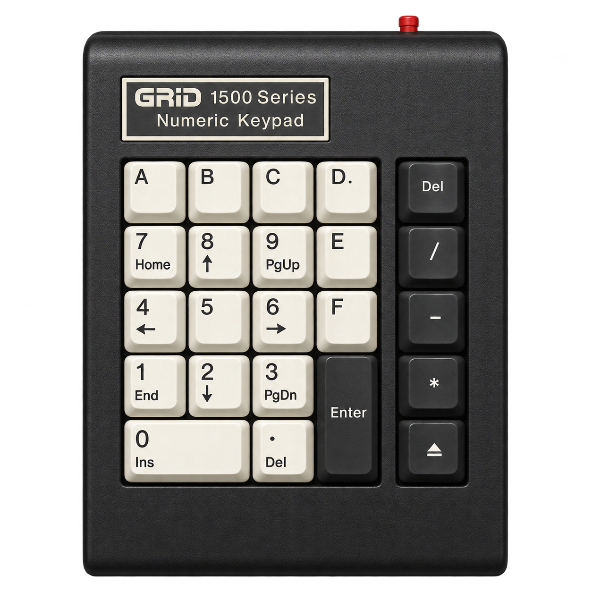
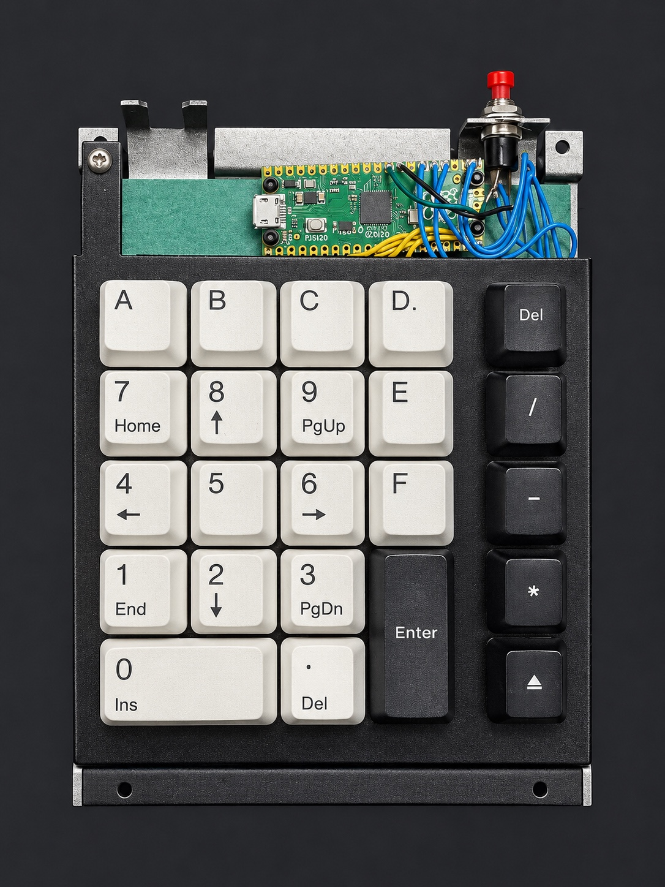
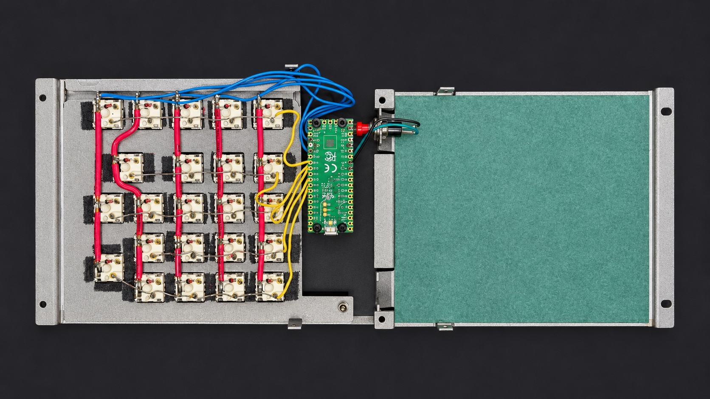

# GRiD 1500 keypad



Custom USB numeric keypad. The case is a GRiD 1500 Series keypad. The
electronics and keycaps are new: a Raspberry Pi Pico (RP2040) running the
[RMK](https://github.com/rmk-rs/rmk) keyboard firmware in Rust.

The repo root is the RMK firmware. The previous CircuitPython (KMK) firmware is
archived under [`circuitpython/`](circuitpython/).

## Hardware

- **Board:** Raspberry Pi Pico (RP2040)
- **Matrix:** 5 columns × 5 rows, column-to-row diode orientation
  - columns (outputs): GP11 GP12 GP13 GP14 GP15 (left → right)
  - rows (inputs): GP20 GP19 GP18 GP17 GP16 (top → bottom)
- **Red button (GP22):** held while powering on, it enters the RP2040 USB
  bootloader (UF2 mass storage) so the device can be reflashed without pressing
  BOOTSEL.

## Photos





## Keymap

Single layer, matching the old keymap in [`circuitpython/code.py`](circuitpython/code.py).
It is a 5×5 grid (rows top → bottom, columns left → right):

```
A   B   C   D   Bksp
7   8   9   E   /
4   5   6   F   -
1   2   3   Ent *
0   (empty)  .  (empty)  +
```

`A`–`D` and `E`, `F` send the shifted letters (uppercase). The digits use the
numpad keycodes (`Kp1`…`Kp0`), the operators the keypad codes (`KpSlash`,
`KpMinus`, `KpPlus`, `KpAsterisk`, `KpDot`, `KpEnter`, `Backspace`) — the same
characters the main-row codes in the old firmware sent. Two positions on the
bottom row are empty (`KeyAction::No`).

You can remap live over [Vial](https://get.vial.today/) (vendor id `0x6666`,
product id `0x0002`), and the keymap is persisted to internal flash.

## Build & flash

Requires a Rust toolchain (`target thumbv6m-none-eabi`) and the RP2040 tooling:

```sh
cargo install flip-link elf2uf2-rs
rustup component add llvm-tools
```

To build a `.uf2` file you can drag onto the bootloader drive:

```sh
cargo install cargo-make cargo-hex-to-uf2 cargo-binutils
cargo make uf2     # produces grid.uf2
```

To build and flash straight over USB:

1. Hold the red button, plug the keypad in (USB cable), release the button. The
   RP2040 boots into UF2 mass-storage mode.
2. `cargo run --release` uses `elf2uf2-rs` to write the firmware.

## Files

- `src/main.rs` – USB setup, matrix pins, boot-button handling
- `src/keymap.rs` – the keymap (5 rows × 5 columns)
- `src/macros.rs` – RP2040 matrix-pin macro
- `vial.json` – Vial definition for live remapping
- `build.rs`, `memory.x`, `.cargo/config.toml`, `Makefile.toml` – RP2040 build glue
- `circuitpython/` – the original CircuitPython/KMK firmware (archived)
- `docs/` – photos (`grid-keypad.png`, `keypad-front.jpg`, `keypad-internals.jpg`)